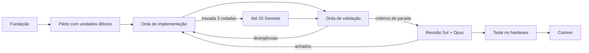

# Plano: port do host Klipper para Rust com paridade byte a byte

## Resumo executivo

- **Escopo.** Todo o host que roda na impressora: core, motion, os 143 extras e o helper C de movimento, cerca de 46,5 mil linhas. O resultado é um binário Rust único que roda no Ender-3 V3 KE (MIPS) e em Linux x86_64. As ferramentas offline e o firmware do MCU ficam como estão.
- **Paridade.** Com a mesma config, o mesmo G-code, os mesmos MCUs simulados e o mesmo relógio virtual, o Rust produz os mesmos bytes que o Python congelado. Isso vale para o stream ao MCU (inclusive sequência e CRC dos blocos), as respostas G-code, os erros, a API, os arquivos escritos, o código de saída e o log.
- **Oráculos.** São dois: um x86_64 fixo e um MIPS emulado com o ambiente da própria pad. Bugs, inclusive comportamento indefinido do C, são reproduzidos como o binário de referência se comporta em cada alvo.
- **Exceções.** São as únicas permitidas, e ficam congeladas numa tabela que os validadores não podem mudar:
  - campos que dependem da máquina ou do processo, como PID, hostname, versão do Python e tracebacks Python;
  - resultados de numpy que só viram texto informativo;
  - macros fora do subconjunto Jinja suportado, que dão erro explícito;
  - o que nenhum simulador reproduz, que fica numa lista nominal.
- **Execução.** Eu faço a fundação e um piloto. Depois, uma orda de 3500 crouton-alpha implementa e outra de 3500 valida, em loop. Unidades travadas vão para até 20 Sonnets. O loop para em critérios medidos: cobertura de Python e C, mutantes detectados e corpus estável. Depois vêm a revisão de um GPT Sol e de um Opus, o teste no hardware e a remoção do Python mainline.
- **Entrega.** Branch `ender-3-v3-ke-rust`, commits locais, sem push.

## O que o planejamento já levantou

- 6 Sonnets mapearam todas as unidades: dependências, contratos, armadilhas e cobertura. Um sétimo revisou este plano e achou 17 lacunas, todas incorporadas abaixo.
- Extraí da pad os dicionários do GD32F303 (firmware Creality `38d96adc-dirty`, 76 comandos e 36 respostas) e do host MCU. O klippy ficou parado alguns segundos e voltou a `ready`.
- Ambiente da pad: Python 3.8.2, greenlet 0.4.15, cffi 1.13.1, Jinja2 2.11.3, markupsafe 1.1.1, pyserial 3.4, numpy 1.16.4 e glibc 2.29. Não há scipy, msgspec nem python-can. A config inclui um `mainsail.cfg` de 313 linhas que só existe na pad.
- Os testes atuais só conferem o código de saída, e nenhum compara saída. No Python, os bytes crus do stream mudam de uma execução para outra, porque a thread C monta os blocos quando acorda. A paridade de bytes crus exige tempo virtual também dentro do C.

## Decisões fechadas

| Tema | Decisão |
|---|---|
| Helper C | Portado para Rust desde o início, sem FFI para o C |
| Paridade | Byte a byte em stream MCU, respostas, erros, API, arquivos escritos, saída do processo e log |
| Extras | Todos os 143 |
| Alvos | KE (MIPS) e Linux x86_64 |
| Oráculo x86_64 | Container com glibc 2.29 exata e os pacotes exatos da pad. Um segundo perfil acrescenta scipy e python-can para cobrir os caminhos que a pad não tem. Python e Rust rodam no mesmo container e na mesma máquina, então a libm resolve as mesmas variantes de CPU |
| Oráculo MIPS | Emulado com o Python, as bibliotecas, o sysroot e o helper C implantados na pad, identificados por hash |
| Referência | Python congelado no commit atual, com as constantes de buffer e flush do fork |
| Tempo | Um serviço de tempo virtual único para Python, helper C, firmware do host MCU, simulador do GD32 e atores externos (cliente API, entrada G-code, filhos de calibração). O tempo avança só quando todos estão parados. Data, hora e fuso de parede também são virtuais |
| numpy e scipy | Byte a byte em tudo que chega ao MCU ou ao SAVE_CONFIG; tolerância declarada só no texto informativo |
| JSON da API | Igual ao do Python sem msgspec, como roda na pad |
| Jinja2 | O subconjunto real usado pelas configs do repo, pelo `mainsail.cfg` da pad e por um corpus público de macros. Fora dele, erro explícito. Mensagens de erro iguais às do Jinja2 2.11.3 nos casos cobertos |
| Bugs latentes | Reproduzidos, com lista separada para corrigir depois nos dois lados |
| Comportamento indefinido do C | Definido como o do binário de referência em cada alvo, com teste nos limites |
| Instrumentação do fork | Portada atrás de uma opção. Os campos sem equivalente em Rust (coletor de lixo, threads Python) ficam mascarados, e o resto é comparado exatamente |
| Contratos externos | API webhooks com os endpoints do c440x, config sem mudança, os dois modos de log, macros, linha de comando, códigos de saída e sinais |
| Fora do escopo | Ferramentas offline, firmware e plugins Python de terceiros |
| Unidade travada | Orda reduzida de até 20 Sonnets |
| Entrega | Branch `ender-3-v3-ke-rust`, autorização ampla de commit, sem push |
| Cutover | Sai a árvore Python mainline. A stack stock da Creality fica, porque desligá-la quebra boot e SSH. Os goldens viram suíte de regressão |

## Fases

### Fase 0: fundação (eu, antes da orda)

A orda só funciona se cada agente puder trabalhar sozinho numa unidade e saber, sem ajuda, se acertou. Cada item abaixo tem critério de pronto.

1. **Insumos rastreados.** Entram como fixtures versionadas:
   - os dicionários: os 2 da pad e os 28 da suíte, recompilados com o campo de versão fixado;
   - o `mainsail.cfg` e as configs stock da pad;
   - o helper C e o firmware do host MCU implantados na pad;
   - os dados reais de trapq que hoje ficam fora do git.

   Os caminhos absolutos da pad são reproduzidos dentro dos oráculos. Pronto quando um clone limpo do repositório monta os oráculos sem nada desta máquina.
2. **Oráculos e tempo virtual.** Monto os dois ambientes da tabela com manifesto de versões. O serviço de tempo virtual entra no Python congelado, no seu helper C e no firmware do host MCU, só como modo de teste e sem mudar comportamento. A fila serial passa a montar blocos de forma determinística. Pronto quando o mesmo cenário roda 20 vezes com bytes crus idênticos, em cada oráculo.
3. **MCUs e periféricos simulados.** O host MCU roda o firmware Linux real. O GD32 roda num simulador montado a partir do dicionário extraído. Os chips de SPI e I2C (sensores, TMC, ADXL, expansores) respondem com sequências roteirizadas. Os dois lados recebem exatamente as mesmas respostas, então a comparação vale mesmo sem realismo do chip.
4. **Corpus de cenários.** Entram os 37 testes atuais, a config real do KE e famílias novas:
   - API e status;
   - pause e resume;
   - SAVE_CONFIG com reinício e arquivo reescrito;
   - macros, incluindo casos de erro;
   - erros de config;
   - M112 fora de ordem com mais de 20 linhas pendentes;
   - entrada G-code pelo pty;
   - rotação de log;
   - CAN por interface virtual;
   - calibrações com processo filho;
   - homing com trsync;
   - aquecedores, sensores em lote e saltos de relógio que disparem a instrumentação de stall.

   Um cenário só entra no corpus depois de 20 execuções idênticas nos dois oráculos.
5. **Gravação por unidade.** O corpus rodando no Python registra entradas, saídas e efeitos de cada unidade. Cada agente testa a sua unidade contra essas gravações.
6. **Camada de compatibilidade com Python.** Ela é escrita uma vez, por mim, para todos. Cobre um tipo de valor dinâmico com a semântica do Python, `repr` e `%` de float, `round`, `int()`, divisão e módulo com piso, inteiros grandes, parsing de config, `shlex`, regex, ordem de dicionário, `sum` e `pow`. Pronto quando passa num fuzz diferencial contra o CPython 3.8.2 da pad.
7. **Arquitetura e contratos congelados.** O reactor cooperativo reproduz a ordem dos greenlets. Ficam fixados antes da orda: o registro de objetos, os esquemas de cada `get_status` e de cada evento, e as threads de step generation e serial. Os critérios dessas threads são três: o chamador bloqueia, as mensagens se juntam na ordem da lista e a regra de primeira falha é igual à do C. Cada unidade tem o seu espaço isolado de edição.
8. **Gate MIPS.** Um binário Rust com a camada de compatibilidade, o reactor e as threads compila contra o sysroot da pad (NaN2008) e roda igual no oráculo MIPS emulado.
9. **Inventário.** Cerca de 1000 unidades de trabalho, cada uma com fonte, gravações, cenários, dependências e classe de verificação:
   - verificada por simulador;
   - verificável só na KE;
   - não verificável nesta pad.

   Os algoritmos que não se dividem (compressão de steps, fila serial, reactor, config, despacho do MCU) entram como blocos marcados. Dividir mais fino que isso quebraria algoritmos de estado único. Por isso as 3500 vagas da orda viram redundância, não unidades menores.
10. **Fila de verificação.** A máquina tem 20 núcleos e 64 GB. Build e testes passam por uma fila central no Linux, e nenhum agente compila sozinho. Cada unidade compila isolada, para que uma verificação leve segundos e não um build inteiro. Cada rodada tem orçamento de execuções definido antes de começar. Se o piloto mostrar que a fila não dá vazão para 3500 agentes, a orda entra em ondas.

**Piloto.** Cerca de 10 unidades portadas por crouton, com pelo menos uma de cada família difícil: reactor, compressão de steps, fila serial, config e Jinja. Ele também mede a vazão da fila. Te mostro o resultado antes de soltar os 3500. Se o crouton não fechar as famílias difíceis, proponho mandar esses blocos direto para os Sonnets.

### Fase 1: orda de implementação (3500 crouton-alpha)

- Cerca de 3000 agentes implementam: cada unidade recebe 3 implementações independentes, com a fonte original, o contrato congelado, as gravações e os cenários. Fica a primeira que passar em todas as gravações.
- As outras implementações aprovadas da mesma unidade viram um teste cruzado. Elas rodam contra entradas novas, e quando duas aprovadas discordam, isso aponta uma lacuna nas gravações. O caso vai para o Python, vira gravação nova, e a perdedora é descartada.
- Os cerca de 500 agentes restantes ampliam as gravações. Cada um gera entradas novas para um grupo de unidades (valores de borda, erros, combinações de config), roda no Python e grava o resultado.
- A unidade está pronta quando reproduz todas as gravações byte a byte no x86_64.
- Todas as unidades começam juntas, porque os contratos estão congelados. A integração sobe em camadas: protocolo MCU, config e G-code, motion, extras, API.
- Integração e commits são meus, em lotes de 100 a 400 linhas que compilam sozinhos.

### Fase 2: orda de validação (3500 crouton-alpha)

- Cada contrato externo ganha um validador dedicado: comando G-code, opção de config, campo de status, endpoint da API e comando ou resposta do MCU. Esses validadores escrevem cenários adversariais e rodam o diff nos dois oráculos.
- Os agentes que sobram leem Python e Rust lado a lado, unidade por unidade, procurando caminhos que nenhum cenário exercita.
- Cada divergência vira um ticket com um cenário mínimo. O cenário só entra no corpus depois de passar no teste de estabilidade.
- Em cada rodada, eu planto divergências conhecidas no Rust (mutantes) sem avisar a orda. Elas medem se a validação está de fato pegando erros.

### Loop e critérios de parada

A Fase 1 corrige os tickets e a Fase 2 valida de novo. O loop para quando tudo isto vale ao mesmo tempo:

- o corpus inteiro passa nos dois oráculos;
- a cobertura de linhas e ramos do Python e do helper C atinge tudo que é alcançável sem hardware, e o que falta está na lista nominal;
- a validação pegou todos os mutantes plantados na última rodada;
- uma rodada completa terminou sem divergência nova.

Uma unidade que não fecha em 3 rodadas vai para os Sonnets. Se nem eles fecharem, ela fica bloqueada e eu te pergunto o que fazer.

### Fase 3: revisão final

Um GPT Sol e um Opus revisam o conjunto: contratos externos, a tabela de exceções, a lista de bugs e de comportamento indefinido reproduzidos, e as classes de verificação. O que eles acharem volta para o loop.

### Fase 4: teste no hardware (com você)

Na pad, com o Python mainline como retorno rápido, a sequência é esta:
1. Handshake com o GD32, incluindo o reset por CRC que hoje acontece a cada boot.
2. RESTART e FIRMWARE_RESTART.
3. Home e BLTouch.
4. Bed mesh.
5. Medição de ressonância com o ADXL.
6. Display c440x e Moonraker.
7. Impressão de teste.

Onde der, a mesma sequência roda com Python e com Rust, e os logs e streams são comparados. Cada item "verificável só na KE" é marcado como confirmado ou não. Os itens "não verificáveis nesta pad" vão para a declaração final de paridade como não confirmados.

### Fase 5: cutover

O Rust vira o padrão no handover da KE e a árvore Python mainline sai. A stack stock da Creality continua, como hoje. Os goldens e as gravações ficam como suíte de regressão.

## Riscos

- O crouton-alpha pode não dar conta das famílias difíceis. O piloto mede isso antes, e o disjuntor limita o estrago.
- Byte a byte no SAVE_CONFIG exige reproduzir a FFT do numpy 1.16.4, que é FFTPACK e não pocketfft, além da escolha do shaper. É o trecho numérico mais caro do port.
- O simulador do GD32 e os chips roteirizados provam paridade, não realismo. O que eles não modelarem só aparece na Fase 4.
- O alvo Rust para MIPS NaN2008 não tem suporte oficial. O gate da fundação existe para descobrir isso antes da orda.
- Cada rodada são mais de 7000 execuções de agente contra uma fila de 20 núcleos, e o oráculo MIPS emulado é lento. O gargalo é a fila, não a orda. O orçamento por rodada limita o custo, e as ondas evitam que milhares de agentes fiquem parados esperando a fila.

## O que preciso de você

1. Aprovar o plano.
2. Confirmar a autorização ampla de commit na branch `ender-3-v3-ke-rust` para toda a execução, sem push, já que a sua regra padrão vale só por turno.
3. Confirmar duas extensões do que você escolheu. Primeiro, byte a byte do numpy também no SAVE_CONFIG, porque a frequência salva volta ao MCU pela config. Segundo, a remoção do Python só na árvore mainline, mantendo a stack stock.
4. Deixar a pad ligada no início da Fase 0 para uma cópia somente leitura destes itens: ambiente Python, `mainsail.cfg`, configs stock, helper C e firmware do host MCU implantados.
